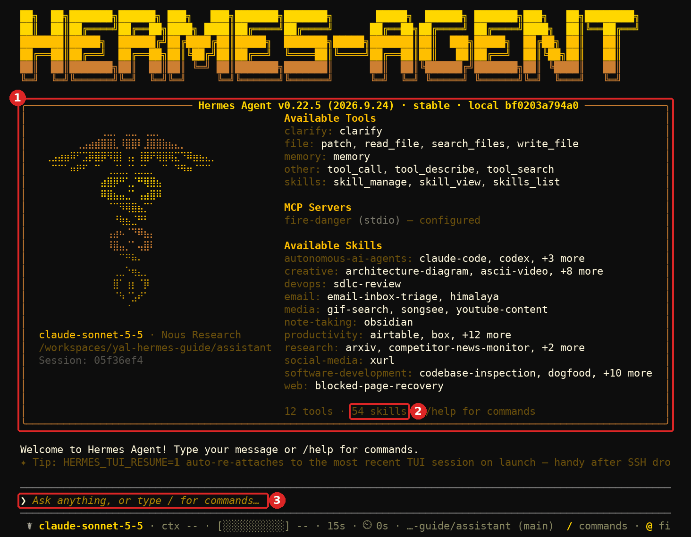
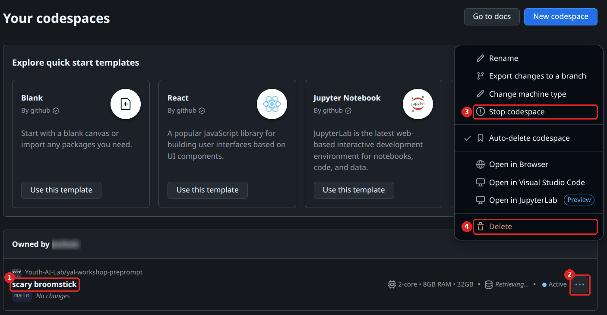

# An assistant that remembers, with Hermes Agent

## Youth AI Lab - Erasmus+ project

- **Partners:** L.A.B. (Aix-en-Provence), UAB (Barcelona), Perlatecnica (Naples), Digitale Wolven
  (Antwerp), CSC Vent des Îles (La Rochelle)
- **Need help?**
  - Read the [Troubleshooting](#troubleshooting) section at the end of this guide.
  - Look at, or open, an [issue](https://github.com/Youth-AI-Lab/yal-hermes-guide/issues).
- **Working with young people?** Read
  [This guide is for you, not for young people](#this-guide-is-for-you-not-for-young-people) first.

> **A guide to follow on your own, in about one hour the first time.** You open a **GitHub
> Codespace** (a computer in your browser, with nothing to install) where **Hermes Agent**, a free
> and open-source AI agent made by Nous Research, is ready. You use it as an assistant to prepare
> your sessions. Unlike a chatbot, it **remembers** you from one conversation to the next, and it can
> **write its own skills**. In this guide, it proposes, and you decide what it keeps. This setup is
> for you, the adult: **not for use with young people**.

This guide is for youth workers, facilitators and educators who work with young people (12 to 25).
It follows the question of the Youth AI Lab workshops: **what enters the model's context, when, and
who decides?** (The *context* is everything sent to the model with one question.) In the workshops, you write everything the chatbot reads. Here, the agent writes
part of it itself: its memory and its skills.

---

## Goals

### What you will be able to do

| Part | You will be able to... |
|---|---|
| **1. Set up** | Open your Codespace, save your key, and ask the assistant a first question. |
| **2. What enters the context** | Say what Hermes sends to the model with each question, and how big it is. |
| **3. Memory** | See what the assistant proposes to remember, approve or reject it, and delete it. |
| **4. Skills** | Approve a skill the assistant proposes, and write one yourself. |
| **5. Tools with MCP** | Get today's fire danger level from a tool. |
| **6. Safety** | Say what the assistant may and may not do in this setup, and what the rules cannot stop. |
| **7. Keep and delete** | Know where your conversations are kept, and delete them. |

### Why this approach?

**An agent, not a chatbot.** A chatbot answers from its instructions and its documents, and forgets
you at the end of the conversation. Hermes keeps a **memory** of you and of your work, and sends it
to the model with each new question. It can also save a way of working as a **skill**, and use it
again later. This is useful to prepare sessions, and it is also new: something you did not write
enters the model's context.

**It proposes, you decide.** By default, Hermes writes its memory and its skills on its own. The
configuration of this guide asks you first: each proposal waits until you approve it.

**In a Codespace, with the dangerous tools off.** Out of the box, Hermes can run commands on the
computer, browse the web, control the mouse and the keyboard, and start other agents. Its own
security page says that "the only security boundary against an adversarial LLM is the operating
system" ([SECURITY.md](https://github.com/NousResearch/hermes-agent/blob/v0.22.5/SECURITY.md)). So
this guide runs it in a Codespace, a computer apart from yours, with only the tools an assistant
needs: read files, write only in its folder of plans, its memory, its skills, and one tool of the
workshops.

**Tested, with the limits we found.** Hermes Agent changes several times a week: this guide is
written for **version 0.22.5** (October 2026), installed at that exact version. Each safety rule is
checked by a test that runs at each change of the guide ([part 6](#part-6---safety-what-the-assistant-may-do)),
and six questions were asked to a real model (Claude Sonnet 5.5) on 29 October 2026. Where something
was not tested, the guide says so.

### Is this guide for you?

**You prepare sessions, workshops or activities** and want to try an assistant that learns how you
work: this guide is for you.

**You took part in a Youth AI Lab workshop**: you will meet the same pieces (instructions in
`AGENTS.md`, skills, an MCP tool), and one more: a memory that the agent writes itself. No workshop
is needed first, but it is easiest after workshop 4 of
[the series](https://github.com/Youth-AI-Lab/yal-workshop-kit#the-series): instructions come in
workshop 1, skills in workshop 3, the MCP tool in workshop 4. It is for you, the facilitator: never
for use with young people.

**You want a chatbot that young people use**: this guide is not the right tool. Use the
[Open WebUI guide](https://github.com/Youth-AI-Lab/yal-openwebui-guide).

### Prerequisites

You need a **GitHub account**, an **Anthropic API key** (see the
[OpenCode guide, way 1](https://github.com/Youth-AI-Lab/yal-opencode-guide#way-1---an-anthropic-api-key)
to get one), and about **one hour**. No technical knowledge is expected: every command to type is
given.

**For your work, use a key of your organisation**, created with its approval, not your personal
card: what Anthropic does with the data, and the contract it needs, are in the
[OpenCode guide](https://github.com/Youth-AI-Lab/yal-opencode-guide#where-the-data-goes). Before you
create your Codespace, choose a region in Europe, as in
[Your GitHub account](https://github.com/Youth-AI-Lab/yal-opencode-guide#your-github-account)
(OpenCode guide): your conversations and the memory then stay in Europe. It does not change where
your questions go.

**Are you ready?** You are if you can name one session you will prepare soon, and two or three
things about your groups that an assistant should know (their age, their size, the length of your
sessions).

---

## This guide is for you, not for young people

**Never use this assistant with young people**, and never let them type in it. Its memory makes
this stricter than for a chatbot:

- **Never type anything about a real young person or a real situation**: no name, no school, no
  health or family detail, no real incident, nothing that could identify someone, even without a
  name. Describe needs in general terms ("a group of 14-year-olds, one with a physical disability"),
  or invent the example. Everything you type is sent to the model and kept in your Codespace, and it
  may be **proposed for the memory**, which is sent with every later question.
- **What we saw.** Asked to remember an invented 14-year-old's name, school and health condition, the
  assistant refused: "I won't save that. Lea's name, her health condition and her school are exactly
  the kind of identifying information I'm set not to keep in memory, even when you ask me to." This
  comes from its instructions (`assistant/AGENTS.md`); a model can still get it wrong, and only your
  approval decides.
- **Your own tests: invented examples only.** Everything you type is sent to the company that runs
  the model, and kept in your Codespace ([part 7](#part-7---keep-and-delete)).
- **Never put a document about young people in the Codespace**: no participant list, form,
  evaluation, photo or message. The assistant can open any file of the Codespace, and what it opens
  is sent to Anthropic ([part 6](#what-the-rules-cannot-stop)).
- **No messaging app.** Hermes can answer on Telegram, WhatsApp, Discord, Signal, e-mail and other
  messaging apps. This guide does not set them up, and you should not: anyone allowed to write to
  the agent there can make it use its tools, and young people could reach it.

**A chatbot for a group** is your organisation's decision: read
[Before any use with a group: your organisation decides](https://github.com/Youth-AI-Lab/yal-opencode-guide#before-any-use-with-a-group-your-organisation-decides)
in the OpenCode guide, and use the
[Open WebUI guide](https://github.com/Youth-AI-Lab/yal-openwebui-guide), whose templates have the
rules that protect a group.

---

## Where the data goes

| What | Where | Who can see it |
|---|---|---|
| Each question, with the instructions, the memory and the documents it reads | sent to Anthropic, with your key | Anthropic, under its [Commercial Terms](https://www.anthropic.com/legal/commercial-terms) (see the [OpenCode guide](https://github.com/Youth-AI-Lab/yal-opencode-guide#where-the-data-goes)) |
| Your conversations, in full | `~/.hermes/state.db`, in your Codespace | you, and GitHub, which runs the Codespace |
| The text of your questions | also in the logs `~/.hermes/logs/agent.log` and `gateway.log` | the same |
| The memory | `~/.hermes/memories/USER.md` and `MEMORY.md` | the same |
| Your key | `~/.hermes/auth.json`, readable only by you | the same |
| Proposals waiting for your approval, in full | `~/.hermes/pending/` | the same |
| After an error with the model (wrong key, no credit...): the whole question, with the instructions and the memory | `~/.hermes/sessions/request_dump_*.json` (read in Hermes's code, **not tested**) | the same |
| Usage statistics for Nous Research | **not sent**: at the first start, Hermes asks whether to share them; the configuration of this guide answers **"No thanks"** for you (`hermes/config.yaml`, section `telemetry`) | - |

The "No thanks" covers only these statistics: your questions still go to Anthropic. Hermes's own
pages disagree on this point: its [FAQ](https://hermes-agent.nousresearch.com/docs/reference/faq)
says that it collects no telemetry, its developer documentation describes this optional sharing.

---

## Part 1 - Set up

### Step 1 - Open your Codespace

1. Open <https://codespaces.new/Youth-AI-Lab/yal-hermes-guide> and sign in to GitHub.
2. Click **Create codespace**.
3. Wait. The first time, the Codespace installs Hermes: about four minutes in all, measured once in
   a real Codespace, with its creation (the installation took 99 and 124 s on our computer with
   the same image).

**What you should see.** VS Code in your browser, with the files of the guide on the left, and a
terminal at the bottom that says **"Welcome! Start the assistant of this guide with: hermes"**. The
terminal is in the folder `assistant/`.

> [!WARNING]
> **The next times, do not use this link again**: it would create a new Codespace, without your
> memory and your conversations. Go to <https://github.com/codespaces> and click the **name** of
> your Codespace.

> [!CAUTION]
> **Never choose Rebuild Container**, nor accept a rebuild that VS Code suggests. It deletes
> everything outside the folder of the guide: your key, your memory, your conversations and your own
> skills. Hermes is then installed again, empty. If it happened, do step 2 again.

### Step 2 - Save your key

In the terminal, type:

```bash
hermes auth add anthropic --type api-key
```

1. At **"Paste your API key:"**, paste your key (`Ctrl+Shift+V`, `Cmd+V` on a Mac) and press Enter.
   Each character shows as a `*`.
2. At **"Label (optional, default: api-key-1):"**, press Enter.

**What you should see.** **`Added anthropic credential #1: "api-key-1"`**. Hermes keeps the key in
`~/.hermes/auth.json`, outside the folder of the guide, readable only by you. `hermes auth list`
shows its label, never the key.

### Step 3 - Start the assistant and ask a question

```bash
hermes
```

**What you should see.** A box **"Hermes Agent v0.22.5"** with the list of the tools and skills (its
last line counts them: **"12 tools · 54 skills"**), then **"Welcome to Hermes Agent! Type your message
or /help for commands."** and a line where you type.



Ask:

```text
What fire danger vigilance levels exist in Charente-Maritime? Name your source.
```

**What you should see.** The assistant reads `knowledge/index.md`, then the document it needs, and
answers with the six levels (FAIBLE to EXCEPTIONNEL), the territory, the order that sets them, and
**"Source: knowledge/30-charente-maritime-vigilance-levels.md"** (what Claude Sonnet 5.5 answered on
29 October 2026; the words change from one answer to the next). Before the very first answer, Hermes
downloads a package it needs: this happens only once. To leave, type `/exit`.

> [!TIP]
> In the terminal, paste with `Ctrl+Shift+V` (`Cmd+V` on a Mac). The first time, the browser may
> ask for permission to paste: click **Allow**.

> [!TIP]
> **Two places to type.** Before you type `hermes`, you are in the terminal: there you type the
> commands of this guide that start with `hermes`, `code` or `mkdir`. After you type `hermes`, you
> are in Hermes: there you type your questions and the commands that start with `/`. To type a
> terminal command while Hermes runs, open a second terminal with the **+** above the terminal, or
> leave Hermes with `/exit`.

### Free quota

A Codespace stops after 30 minutes without use. Stop it yourself after use: on
<https://github.com/codespaces>, its **…** menu → **Stop codespace**. GitHub deletes a Codespace
that stayed stopped for 30 days, and with it your memory, your conversations, your key and your own
skills. GitHub Free gives 120 core-hours a month: 60 hours on the 2-core machine of this guide.



---

## Part 2 - What enters the context

With each question, Hermes sends the model much more than your words. We measured it, with a fake
model that records what it receives:

| What | Size (characters) | Who wrote it |
|---|---|---|
| Hermes's own instructions, with `assistant/AGENTS.md` (under the title "Project Context") and the **list of its skills** (51 lines, 5,200 characters; the "54 skills" of the welcome box is another count) | about 16,400 | Nous Research, and you for `AGENTS.md` |
| The memory: `USER PROFILE` and `MEMORY` blocks | up to 1,375 and 2,200 | **the assistant**, after your approval |
| The description of the 12 tools it may use | about 18,600 | Nous Research |
| A one-line entry for each tool of the MCP server | a few lines | the author of the server |

Measured with Hermes 0.22.5 and the configuration of this guide (29 October 2026). Without this
configuration, Hermes sends **20 tools** (37,500 characters), among them a terminal, a browser and
the control of other agents.

**The past conversations are not in it.** Hermes has a tool, `session_search`, that searches all
your past conversations and brings back what it finds. We tried it: in a new conversation, the model
found by itself the health condition of an invented participant that it had refused to remember the
day before, and sent it to Anthropic again. The configuration of this guide removes this tool: only
the memory you approved goes from one conversation to the next.

**The memory is in every question.** When you approve a memory, it appears in the instructions of
every question of your **next** conversations, with its size (not in the current one: Hermes reads
the memory when a conversation starts; leave with `/exit` and start `hermes` again, or type `/new`):

```text
USER PROFILE (who the user is) [4% — 65/1,375 chars]
The facilitator works with groups of 15-year-olds in La Rochelle.
```

> [!NOTE]
> **Compare with the workshops.** In the workshops, you write `AGENTS.md`, you add the documents,
> you choose the skills: everything that enters the context comes from you. Here, Hermes also comes
> with about fifty skills of its own (the welcome box counts them), and the agent proposes its
> memory and new skills. The question "who decides?" gets a new answer: you, at each approval.

---

## Part 3 - Memory

Hermes has two memories, two short text files sent with every question:

- **`USER.md`**, the user profile: who you are, how you work (1,375 characters at most);
- **`MEMORY.md`**, the agent's notes: facts about your work and your projects (2,200 characters at
  most).

### See and approve what it proposes

When the assistant wants to remember something, Hermes shows **`🧠 Memory +user: "…"`** with the
text, then **"updated 1 memory"** under the answer. The memory is **not saved yet**: it waits for
your approval. Type:

```text
/memory pending
```

**What you should see.**

```text
Pending memory writes (1):
  e7628ac8  add to user profile: The facilitator works with groups of 15-year-olds in La Rochelle.
Apply: /memory approve <id>   Reject: /memory reject <id>
```

Then type `/memory approve` followed by the code of the line (here `e7628ac8`), or `/memory reject`
and the code. Only an approved line is written in the file. `/memory reject all` rejects every
proposal still waiting.

> [!IMPORTANT]
> **Reject anything about a young person**, even if you typed it yourself by mistake: a name, a
> school, a health or family detail. And reject what is wrong or out of date: the assistant will
> believe it in every later conversation.

### Read, change or delete the memory

The two files are in `~/.hermes/memories/`. To open one in VS Code, type in the terminal (not in
Hermes):

```bash
code ~/.hermes/memories/USER.md
```

In these files, one memory is separated from the next by a line with only `§`. To delete a memory,
delete its text and one `§` line; leave the other memories and their `§` lines as they are. Save.
The change is used from the next conversation. To delete **all** the memory:

```bash
hermes memory reset
```

**What you should see.** Hermes lists the files and asks **"Type 'yes' to confirm:"**. Type the word
`yes` (`y` cancels). Then **"✓ Deleted USER.md (user profile)"** (and `MEMORY.md` if it exists) and
**"Memory reset complete. New sessions will start with a blank slate."**

> [!IMPORTANT]
> `hermes memory reset` empties the two files only. Proposals still waiting stay (`/memory reject
> all` in Hermes), and each earlier conversation keeps what you typed, in `state.db` and in the logs.
> If something about a real young person was typed, see
> [part 7](#at-the-end-or-if-you-typed-something-real-by-mistake).

### Try it

1. Start `hermes` and send two invented facts, in two separate messages: "Remember this: my sessions
   last two hours." then "Remember this: my groups are twelve 14-year-olds."
2. After each message, read what the assistant answers.
3. Type `/memory pending`, approve one line, reject the other. If both facts come as one proposal,
   reject it and ask again, one fact per message.
4. Leave (`/exit`), start `hermes` again, and ask: "What do you know about my sessions?"

**What you should see.** At step 2, the assistant answers that the memory is "Not saved yet" and
staged, with its code, and shows the line it proposes (what Claude Sonnet 5.5 did on 29 October
2026). At step 4, the approved fact should be known and the rejected one not (**not tested**).

---

## Part 4 - Skills

A **skill** is a short text file (`SKILL.md`) that tells the agent how to do one kind of task. It is
the same format as the skills of the workshop kit. Hermes reads only the name and one line of each
skill with every question, and opens the whole skill when it needs it.

### A skill the assistant proposes

When you ask for the same kind of preparation again, the assistant may propose a skill. Type:

```text
/skills pending
```

**What you should see.** **"Pending skills writes"**, one line per proposal, then
**"Apply: /skills approve <id>   Reject: /skills reject <id>"** and **"Review full diff: /skills
diff <id>"**. Before you approve it, type `/skills diff` followed by its code (at the start of its
line): it shows the whole text of the proposed skill.

> [!NOTE]
> Hermes refuses, when you approve it, a skill made by the assistant whose description is longer
> than 60 characters ("new skills must fit the 60-char system-prompt budget"): this is the line
> sent with every question. The refused proposal stays in the list: type `/skills reject` and its
> code, then ask: "Propose this skill again with a description of 60 characters or less."

### A skill you write

1. In the terminal (not in Hermes), create the folder of the skill and open its file:

   ```bash
   mkdir -p ~/.hermes/skills/session-plan
   code ~/.hermes/skills/session-plan/SKILL.md
   ```

2. Write in it, then save:

   ```markdown
   ---
   name: session-plan
   description: Use when asked to plan a session. Writes a plan in plans/.
   ---

   # Session plan

   Write the plan in plans/<date>-<topic>.md with: the goal, the timing, the activities and the
   materials. Use only the documents of knowledge/ for facts about wildfires.
   ```

3. Check: `hermes skills list` shows a line **`session-plan`** with **`local`** and **`enabled`**.

Then, if Hermes is running, leave it with `/exit`, start `hermes` again, and ask: "Plan a one-hour session on the vigilance levels for a group of
14-year-olds." **What you should see.** The assistant reads the three documents of `knowledge/`,
asks the fire-danger tool for today's level, writes the plan in `assistant/plans/` and gives its
outline (Claude Sonnet 5.5, 29 October 2026, without the skill: about two minutes and 0.09 dollars).
With the skill: **not tested**.

Whether the assistant **proposes a skill by itself** when you ask for the same kind of preparation
again: **not tested**.

---

## Part 5 - Tools with MCP

**MCP** (Model Context Protocol) is a standard way to plug a small program, a *tool*, into an
assistant. The assistant has the tool of the workshops: **fire-danger**, which gives today's wildfire
danger level of a territory (`mcp/fire_danger_server.py`, its data in `mcp/fire-danger.json`). Ask:

```text
What is today's fire danger level in Charente-Maritime? Name the source.
```

**What happens.** Hermes does not send the full description of MCP tools with each question: only
one line per tool, in a catalogue. The model looks the tool up (`tool_search`), then calls it. What
the tool answers comes back marked as data from an outside source, not as instructions.

**What you should see.** As long as `mcp/fire-danger.json` is not filled in, the assistant says that
the tool gave no level for today, does not guess one, and gives the official source to check
(Claude Sonnet 5.5, 29 October 2026).

### Fill in today's level

1. Open the official source given in the file for your territory (for La Rochelle,
   <https://www.risque-prevention-incendie.fr/17>) and read today's level.
2. In the terminal (not in Hermes), open the file: `code /workspaces/yal-hermes-guide/mcp/fire-danger.json`.
3. Write today's date in `"date"` (year-month-day). For your territory, write `"status"`: `"live"` if
   the source shows a level for today (then copy the level in `"level"` and the advice in
   `"advice"`), `"season-over"` or `"no-level-shown"` if not; and in `"source_says"`, the sentence of
   the source about today. Copy everything as it is. Keep the quotes and the commas. Save.
4. Ask the question again (in a new conversation).

> [!IMPORTANT]
> Never make up a level: copy it from the official source, and keep its address in the file. The
> assistant gives it as today's level. The tool gives a level only when the status is `"live"` and
> the date is today's: otherwise it says that there is no level today, and why.

The [OpenCode guide, part 6](https://github.com/Youth-AI-Lab/yal-opencode-guide#fill-in-todays-level)
explains the file in more detail.

---

## Part 6 - Safety: what the assistant may do

The configuration of the guide is `hermes/config.yaml`, copied to `~/.hermes/config.yaml` when the
Codespace was created. Each line has a comment. A test ([`ci/check_hermes.py`](ci/check_hermes.py))
makes a fake model ask for each of these actions, as a model tricked by a document could, and
checks what Hermes does:

| The model asks to... | Hermes |
|---|---|
| save a memory, or a new skill | stages it, until you approve it |
| search the past conversations (`session_search`) | refuses: the tool is not there |
| run a command (terminal), directly or through `tool_call` | refuses: the tool is not there |
| write a file in `assistant/plans/` | writes it |
| change a document of `assistant/knowledge/`, or write anywhere else, `~/.bashrc` included | refuses ("outside HERMES_WRITE_SAFE_ROOT") |
| read the files of your key (`~/.hermes/auth.json`, `~/.hermes/.env`) | refuses ("Access denied") |
| call the fire-danger tool | calls it |

The folder where it may write is set by `HERMES_WRITE_SAFE_ROOT` in
`.devcontainer/devcontainer.json`. Its files of instructions (`AGENTS.md`, `CLAUDE.md`, `SOUL.md`)
have one more rule, Hermes's own: it always asks a person before it writes them, even in `--yolo`
mode (read in Hermes's code; the test does not try it, because nobody can answer there).

### What the rules cannot stop

- **It can read other files of the Codespace**: the guide, the documents, your other files. Only
  the files of the key are refused (and `/proc/self/environ`, where programs keep their settings).
  Keep nothing personal in the Codespace. A Codespace also keeps a GitHub token for the repository
  it was made from, in a file the assistant can open (`/workspaces/.codespaces/shared/`). In our test
  with a fake token of the same kind, Hermes replaced it with `«redacted:ghu_…»` before sending the
  file to the model (the test of part 6 checks this at each change). Create your Codespace from this
  guide's repository only, as in part 1.
- **The model sees everything you type and everything it reads**, and so does Anthropic.
- **A document can trick it.** A text in a document may ask the agent to remember something, to
  write a skill, or to write a plan that says something else. Memories and skills are only proposed:
  read each proposal before you approve it. Read the plans before you use them.
- **You can turn the rules off.** `hermes tools`, `hermes chat -t …` or `hermes chat --yolo` change
  the tools or the approvals for you, the person at the keyboard. The assistant itself has no
  terminal to type them.
- **Some commands inside Hermes turn the rules off too.** Never type `/yolo`, `/approvals`, `/tools`,
  `/memory approval` or `/skills approval`: each one changes a rule of this guide. Never type
  `/update` (a version this guide has not tested), `/init` (it rewrites the instructions of the
  assistant) or `/debug` (it uploads your logs, with the text of your questions, to share them).
- **Skills you install yourself are not checked.** `hermes skills install` adds a skill without the
  approval of this guide. This guide needs none; if you install one, read all its files first, as
  Hermes's [security page](https://github.com/NousResearch/hermes-agent/blob/v0.22.5/SECURITY.md)
  asks.
- **A newer Hermes may behave differently.** The guide installs version 0.22.5 and its test checks
  it. Do not run `hermes update`.

Each time you start `hermes`, it also starts a helper in the background (its log is `gateway.log`),
which runs the tools and stops by itself some minutes after you leave. It has nothing to do with
messaging apps.

---

## Part 7 - Keep and delete

**Deleting the Codespace is the only way that removes everything** from it (see the end of this
part). To delete pieces:

| To... | Type (in the terminal, not in Hermes) |
|---|---|
| list your conversations | `hermes sessions list` |
| delete one conversation | `hermes sessions delete` followed by its ID, then `y` at **"[y/N]"**: you should see **"Deleted session '…'."** |
| delete the logs, which keep the text of your questions | `rm -f ~/.hermes/logs/*.log*` |
| delete all the memory | `hermes memory reset` ([part 3](#read-change-or-delete-the-memory)) |
| reject the proposals still waiting | `/memory reject all` and `/skills reject all`, in Hermes |
| remove your key from the Codespace | `hermes auth remove anthropic api-key-1` |

Deleting a conversation removes it from the list; whether the file `state.db` still holds its text
until Hermes compacts it is **not tested**.

> [!WARNING]
> **`hermes backup` puts your key in the archive** (with the configuration and the conversations),
> in your home folder (`~/hermes-backup-….zip`). Never share such an archive.

### At the end, or if you typed something real by mistake

1. **Stop** using the assistant.
2. **Revoke the key** in the Anthropic console: a key removed from the Codespace still works
   elsewhere.
3. **Delete the Codespace** on <https://github.com/codespaces> (**…** → **Delete**): this deletes
   its conversations, logs, memory and skills. It does not delete what you downloaded (an export,
   a backup) or what was already sent to Anthropic, which keeps it under its own terms.
4. **If it was about a real young person**: write down what you typed and when, and tell whoever
   handles data protection in your organisation.

---

## A model on your own computer

Hermes can also use a model that runs on a computer of your organisation, with Ollama (see the
[local AI guide](https://github.com/Youth-AI-Lab/yal-local-ai-guide)): nothing then leaves the
organisation. Hermes's documentation asks for a model that can call tools and a context of at least
**64,000 tokens** ([pieces of words](https://github.com/Youth-AI-Lab/yal-local-ai-guide/blob/main/how-an-llm-works.md#what-a-token-really-is), the unit models count and bill), and recommends a large model
(`gemma4:31b`, 24 GB of memory or more)
([Hermes with Ollama](https://hermes-agent.nousresearch.com/docs/guides/local-ollama-setup)).

**What we measured** (29 October 2026, a laptop with a 6 GB graphics card, Ollama 0.40.8, the
configuration of this guide, the question of part 1):

| Model (from the local AI guide) | What happened | Time |
|---|---|---|
| `qwen2.5:7b` | no answer: it called the tools the wrong way six times, and never read its documents | 83 s |
| `mistral:7b` | a wrong answer: it called no tool, gave three levels instead of six, and named a document that does not exist | 105 s |

Both models stop at 32,768 tokens of context, even when asked for 65,536, and did not fit in the
card (19 % and 49 % of the work on the processor). **So this guide does not work with a small local
model.** With a larger model, on a computer with much more memory: **not tested**.

## Costs

Each question sends the instructions, the memory and the descriptions of the tools: about 35,000
characters before your own words ([part 2](#part-2---what-enters-the-context)), and again with each
tool the assistant uses. Measured on 29 October 2026 with Claude Sonnet 5.5, as estimated by Hermes
from Anthropic's prices:

| Question | Calls to the model | Estimated cost |
|---|---|---|
| The vigilance levels, from one document (part 1) | 3 | 0.045 dollars |
| "Remember this" (part 3) | 2 | 0.016 dollars |
| Today's danger level with the MCP tool (part 5) | 3 | 0.021 dollars |
| A one-hour session plan, written in `plans/` (part 4) | 6 | 0.089 dollars |

Six questions cost 0.21 dollars in all. Most of what is sent is the same at each call, and
Anthropic charges it less when it is repeated (its prompt cache). In the Anthropic console, the
spending limit is set on the **workspace** of your key, not on the key itself (**Spending** →
**Spend limits**, as in the
[OpenCode guide, way 1](https://github.com/Youth-AI-Lab/yal-opencode-guide#way-1---an-anthropic-api-key)):
create your key in a workspace with a limit, since the workspace **Default** cannot have one.

## Limits to know

- **A real model was tried with six questions only** (Claude Sonnet 5.5, 29 October 2026). Not
  tested: whether the assistant proposes a skill by itself, and a long conversation.
- **Hermes changes fast.** The guide is pinned to 0.22.5; its documentation online describes the
  latest version.
- **No group, no young people, no messaging app** ([why](#this-guide-is-for-you-not-for-young-people)).
- **OpenRouter and other providers**: Hermes accepts them (`hermes auth add openrouter`), not tested
  here.

## Commands

| Command | What it does |
|---|---|
| `hermes` | starts the assistant |
| `hermes auth add anthropic --type api-key` | saves your key |
| `hermes auth list` | shows the saved keys (labels only) |
| `/memory pending`, `/memory approve <id>`, `/memory reject <id>` | in Hermes: the memory proposals |
| `/skills pending`, `/skills diff <id>`, `/skills approve <id>`, `/skills reject <id>` | in Hermes: the skill proposals |
| `/new` | in Hermes: starts a new conversation (and reads the memory again) |
| `/exit` | in Hermes: leaves |
| `hermes skills list` | lists the skills |
| `hermes tools list` | lists the tools and whether they are enabled |
| `hermes sessions list` | lists the conversations |
| `hermes memory reset` | deletes all the memory |

## Troubleshooting

### "No Anthropic credentials found"

The key is not saved: do [part 1, step 2](#step-2---save-your-key).

### `hermes`: command not found

The Codespace was still installing Hermes when you opened the terminal. Wait until the installation
ends, then open a new terminal (the **+** above the terminal).

### "Write denied: … is outside HERMES_WRITE_SAFE_ROOT"

The assistant tried to write outside `assistant/plans/`: this is the rule of the guide. Ask it to
write in `assistant/plans/`.

### "Staged for approval"

The assistant proposed a memory or a skill: see [part 3](#see-and-approve-what-it-proposes) and
[part 4](#a-skill-the-assistant-proposes).

### Hermes asks "Help improve Hermes?"

The configuration of the guide was not copied (it records "No thanks"). Keep **No thanks** (it is
already chosen) and press Enter, then tell us in an
[issue](https://github.com/Youth-AI-Lab/yal-hermes-guide/issues).

### The key is refused

Check the key, its credit and its workspace in the Anthropic console. Then type
`hermes auth remove anthropic api-key-1` and do [part 1, step 2](#step-2---save-your-key) again. The
message Hermes shows: **TO BE COMPLETED** (not tested with a refused key).

### The assistant does not know its documents or its instructions

Hermes reads `AGENTS.md` in the folder where you start it. Leave with `/exit`, type
`cd /workspaces/yal-hermes-guide/assistant`, then `hermes`.

### The assistant asks me to run a command or to change a setting

Do not do it: in this guide, it has no terminal on purpose ([part 6](#part-6---safety-what-the-assistant-may-do)).

### My key, my memory and my conversations are gone

The Codespace was rebuilt, or deleted after 30 days stopped: see
[part 1, step 1](#step-1---open-your-codespace). Do part 1, step 2 again.

### The installation failed

Open the creation log (command palette, `Ctrl+Shift+P`: **Codespaces: View Creation Log**), then, in
the terminal, in the folder of the guide: `bash .devcontainer/setup-hermes.sh` (**not tested**).

---

## Going further

- Hermes Agent: [repository](https://github.com/NousResearch/hermes-agent) (MIT licence),
  [documentation](https://hermes-agent.nousresearch.com/docs/),
  [memory](https://hermes-agent.nousresearch.com/docs/user-guide/features/memory),
  [skills](https://hermes-agent.nousresearch.com/docs/user-guide/features/skills),
  [security](https://github.com/NousResearch/hermes-agent/blob/v0.22.5/SECURITY.md)
- The Youth AI Lab [workshop kit](https://github.com/Youth-AI-Lab/yal-workshop-kit), and the
  [OpenCode](https://github.com/Youth-AI-Lab/yal-opencode-guide),
  [Open WebUI](https://github.com/Youth-AI-Lab/yal-openwebui-guide),
  [local AI](https://github.com/Youth-AI-Lab/yal-local-ai-guide) and
  [dev containers](https://github.com/Youth-AI-Lab/yal-devcontainer-guide) guides
- **No Codespace?** The [dev containers guide](https://github.com/Youth-AI-Lab/yal-devcontainer-guide)
  opens this repository on your own computer, with the same image as a Codespace. The test of
  part 6 ([`ci/check_hermes.py`](ci/check_hermes.py)) runs in such a container at each change, on
  Linux; on macOS and Windows: **not tested**.

## About

Written for the Youth AI Lab project (Erasmus+), October 2026, for Hermes Agent v0.22.5 (commit
`bf0203a`). **Image tested**: `2026.10.31` of the workshops (`2026.10.30` for the measures of
29 October). **Image used**: the one pinned in
[`.devcontainer/devcontainer.json`](.devcontainer/devcontainer.json) (`2026.10.36` on 30 October
2026), which the workflow of [`ci/README.md`](ci/README.md) opens at each change; the measures and
the questions to the real model were not repeated with it. Checked on 29 October 2026 in a container
made from this repository: the installation, the configuration, the measures of part 2, the
screens of parts 1, 3 and 4 (with a fake key and a fake model), each line of the table of part 6, by
[`ci/check_hermes.py`](ci/check_hermes.py), which runs at each change
([`ci/README.md`](ci/README.md)), and six questions to Claude Sonnet 5.5 with a real key (answers,
tools used, costs). In a real Codespace (image `2026.10.30`), we ran the installation and
`ci/check_hermes.py` only (22 PASS, 0 FAIL, before the token check was added), not the whole guide.
Not tested: a skill proposed by the assistant itself, a long conversation.

The documents of `assistant/knowledge/` are summaries 30 to 32 of the workshop kit, and the MCP
server comes from the kit.

Texts: [CC BY-SA 4.0](LICENSES/CC-BY-SA-4.0.txt). Configuration and code:
[EUPL-1.2](LICENSES/EUPL-1.2.txt). See [`REUSE.toml`](REUSE.toml).
